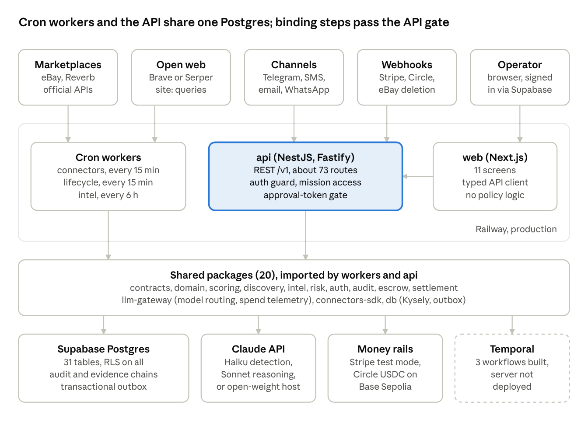

# Opportunity OS — Application Audit

Oct 15, 2026 · @Sid

## Purpose and how to use this audit

This audit is the baseline of Opportunity OS (repo `sidnicholas/soko`) as of main at `b64c312` plus uncommitted intel cost work, 2026-10-15. Use it to merge a second feature document, then bring the merged features back as work against this codebase.

- **Source of truth:** the code, `docs/Opportunity_OS_PROJECT_MEMORY.md` (implementation state), `docs/Opportunity_OS_TECHNICAL_REQUIREMENTS.md` (requirements, cited here as §N), and 32 ADRs in `docs/adr/`. Where this audit and the code disagree, the code wins.
- **When merging:** map each new feature to a section here (which package owns it, which tables it touches, which invariant applies). Section 19 is the checklist a returning feature must pass.
- **Status words used:** *Live* = deployed and running in production. *Built* = in the code and tested, not deployed or not switched on. *Reference* = simulated or in-memory stand-in. *Planned* = not built.

## Executive summary

Opportunity OS is a V1 in active build: Phases 0–4 are complete, Phase 5 (learning and scale) has not started, and no real money moves yet. It finds unmet demand and idle supply, matches and scores them deterministically, and puts every binding step (outreach, purchase, payment) behind a human approval.

| Phase | Scope | Status |
| --- | --- | --- |
| 0 Foundation | Monorepo, CI, config, migrations, hash-chained audit, outbox, RLS | Complete |
| 1 Economic nervous system | Demand parsing, connectors, matching, scoring, market graph, graph deals | Complete; eBay and Reverb live |
| 2 Human-controlled execution | Approval tokens, negotiation drafting, durable approval wait | Complete |
| 3 Native money rails | Settlement abstraction, escrow engine, Stripe test mode, Circle USDC on Base Sepolia | Complete on test rails; production rails need a licensed partner |
| 4 Public demand marketplace | 11 web screens, search, sharing, steering, timelines | Complete except agent-to-user questions |
| AIOOS intel (extended PRD) | Web search + Claude pipeline, Action Queue, runtime sources | Live on a $1/day cap |
| Marketplace + off-network deals | Unmatched demand/supply listing, deal tracking | Live (tracking only) |
| 5 Learning and scale | Score calibration, source-yield learning, search index, AWS | Planned |

**Live in production (Railway + Supabase):** `api`, `web`, and cron workers `worker-lifecycle` and `worker-connectors` (every 15 minutes) and `worker-intel` (every 6 hours). Supabase JWT auth is live. eBay ingestion has been live since 2026-10-12.

**Scale of the codebase:** 9 apps, 20 packages, 23 SQL migrations, 46 versioned event types, 32 ADRs, 62 commits since 2026-09-01. The last recorded full suite was 230 pass, 1 skip.

## Product scope and domain model

The product is a demand-first transaction-discovery network: an opportunity can come from any signal, even from two unrelated facts with no listing, and every completed deal feeds a learning loop. It is model-agnostic, and fiat and on-chain settlement sit behind one abstraction from day one.

**Economic spine** (each arrow is a persisted stage):

`Signals → Entities/Graph → Supply → Demand → Matches → Opportunities → Negotiations → Transactions → Settlement → Outcomes`

| Concept | What it is | Where it lives |
| --- | --- | --- |
| Mission | A user's standing request ("find me X under $Y"), versioned on every edit | `missions`, `mission_versions` |
| Demand | Structured `DemandSpecification` parsed from a mission or signal | `demands`, `packages/demand` |
| Supply | A normalized listing from a connector or signal | `supply`, `packages/connectors-sdk` |
| Signal | Raw intake from any channel (web form, Telegram, SMS, email, WhatsApp) | `signals` |
| Entity | A canonical item resolved across listings, with price history and graph edges | `entities`, `entity_members`, `price_observations`, `graph_edges` |
| Match | A demand–supply pair with sub-scores and rationale | `matches` |
| Opportunity | A scored deal shown to the operator; from a match or from the graph (arbitrage, bundle) | `opportunities` |
| Approval | A human decision that mints a single-use token bound to exact terms | `approvals` |
| Negotiation | A drafted, approval-gated message to a counterparty | `negotiations` |
| Transaction | A proposed or agreed deal | `transactions` |
| Settlement plan | How money moves: rail, milestones, release conditions, recipients | `settlement_plans`, `settlement_milestones`, `evidence` |
| Outcome | The result of a deal, the fuel for learning | `outcomes` |
| Intel lead / candidate | A web-sourced need, and its assessed opportunity | `intel_leads`, `intel_candidates` |
| Off-network deal | An operator's own counterparty for an unmatched listing | `offnetwork_matches` |

**Human-control principles:** the system may discover, draft and recommend on its own. It may never send outreach, commit to a purchase, or move money without a valid human approval token bound to the exact terms. Scoring and escrow release are deterministic code; a model can estimate inputs but never decides.

## Architecture

The system is a modular monolith split into deployable hosts (ADR-004): three cron workers and the API import the same 20 packages and share one Postgres, and only the API can take a binding action. It is built to split into services later without changing package boundaries.

Workers ingest, discover and score on a schedule; the API serves the web console, receives webhooks, and is the only place approval tokens are checked. The dashed box is built but not running.

**Key architectural decisions**

- **Modular-first, microservice-ready** (ADR-004): domain logic in packages, apps as thin composition roots; apps never import each other (the API starts Temporal workflows by type name, not by importing worker code).
- **Postgres as system of record** (ADR-005) with **transactional outbox** (ADR-007): state and events commit together; consumers can be added later without dual writes.
- **Sync first, durable opt-in** (ADR-019, 021): every flow works synchronously through the API; Temporal workflows are an optional, best-effort durable path that never blocks the synchronous one.
- **Central LLM gateway** (ADR-008): provider routing by task class, fallback chains ending in a deterministic echo stub, per-task cost ceilings, untrusted-content fencing, schema-validated output with every attempt billed.
- **Rail-neutral settlement** (ADR-010): one service, pluggable rails selected by `rail_family`; blockchain used for settlement and proofs only (ADR-011).
- **Deterministic final decisions** (ADR-015): models estimate, versioned code scores, buckets and releases funds.
- **Railway first, AWS portable** (ADR-013): plain OCI containers, no Railway-specific APIs; cron services bill only while running.
- **Keyless by default:** every external provider has a simulated or echo fallback, so local dev and CI need no accounts.

## Tech stack

The whole system is strict TypeScript (ESM) on Node 24 in a pnpm + Turborepo monorepo, with Postgres as the system of record. Versions below are the declared ranges in each `package.json`.

| Layer | Choice | Version | Decision record |
| --- | --- | --- | --- |
| Language / runtime | TypeScript strict, ESM; Node (`.nvmrc` = 24, engines ≥ 20) | TS ^5.6.3 | ADR-001 |
| Monorepo | pnpm workspaces + Turborepo | pnpm 9.12.3, turbo ^2.2.3 | ADR-001 |
| Backend API | NestJS on Fastify, OpenAPI via `@nestjs/swagger` | Nest ^10.4.7, Fastify ^4.28.1 | ADR-003 |
| Frontend | Next.js + React, `@supabase/supabase-js` for sign-in | Next ^14.2.18, React ^18.3.1 | ADR-002 |
| Database | PostgreSQL on Supabase; Kysely query builder over `pg` | Kysely ^0.27.4, pg ^8.13.1 | ADR-005 |
| Vector search | jsonb embeddings by default; pgvector (HNSW) opt-in | pgvector/pg16 in CI | ADR-024–026 |
| Durable workflows | Temporal (client, worker, workflow, activity) | ^1.11.5 | ADR-006, 021 |
| Messaging relay | Transactional outbox; Redis publisher via ioredis | ioredis ^5.4.1 | ADR-007 |
| Validation / contracts | Zod (v3 API; `zod/v4` for structured-output schemas) | zod 3.25.x | — |
| Auth | Supabase JWT verified with `jose` (JWKS or HS256) | jose ^5 | §22 |
| LLM | Central gateway; Anthropic SDK (Haiku 4.5 fast, Sonnet 5.5 reasoning); OpenAI-compatible hosts optional | @anthropic-ai/sdk ^0.131.0 | ADR-008 |
| Embeddings | OpenAI or Voyage, echo stub by default | — | ADR-025 |
| Fiat rail | Stripe (manual-capture PaymentIntents, Connect transfers) | stripe ^17.3.1 | ADR-010, 030 |
| Stablecoin rail | Circle Developer-Controlled Wallets (MPC custody), USDC on Base Sepolia | ^10.8.0 | ADR-010, 011 |
| Logging | pino structured logs | ^9.5.0 | — |
| Email | nodemailer (SMTP) | ^10.0.0 | ADR-032 |
| Tests | Vitest; Postgres 16 + pgvector in Docker for live-DB suites | vitest ^2.1.4 | — |
| Hosting | Railway (services + cron); Supabase (Postgres + auth); AWS-portable OCI containers | — | ADR-013 |
| CI | GitHub Actions: typecheck, unit, migrations (run twice for idempotency), pgvector | — | — |

## Repository layout

Business logic lives in 20 packages; the 9 apps are thin hosts that compose them. Packages resolve as `@opportunity-os/<name>` to `packages/<name>/src/index.ts`, and apps never import each other.

**Apps** (`apps/`)

| App | Role | State |
| --- | --- | --- |
| `api` | NestJS/Fastify REST + OpenAPI; 16 feature modules, about 73 routes (see API surface) | Live |
| `web` | Next.js operator and user console, 11 screens | Live |
| `worker-lifecycle` | Refresh sweep: discovery, synthesis, entity resolution, graph edges, graph deals | Live, cron 15 min |
| `worker-connectors` | Risk-gated ingestion from marketplace connectors, query driven by active missions | Live, cron 15 min |
| `worker-intel` | AIOOS web-intelligence sweep under a daily spend cap | Live, cron 6 h |
| `worker-temporal` | Durable workflows: mission discovery, opportunity execution, settlement milestone timer | Built, not deployed |
| `worker-outbox` | Outbox relay to log or Redis publishers | Built, not deployed (no consumers yet) |
| `worker-notifications` | Approval delivery over Telegram, email or log | Built, not deployed (no channel configured) |
| `worker-agents` | Agent runtime host | Stub |

**Packages** (`packages/`)

| Package | Owns |
| --- | --- |
| `contracts` | Zod schemas and types for every entity, event, command, connector and escrow condition; IDs. The single source of truth for shapes. |
| `config` | Validated environment into a namespaced `AppConfig` (`getConfig()`) |
| `domain` | State machines (opportunity, transaction, settlement, negotiation), `assertTransition`, material-term change detection |
| `audit` | Hash-chained audit log, canonical JSON + SHA-256, term hashes for proposals, releases, refunds, negotiation sends, asset transfers |
| `auth` | RBAC permissions, `authorize`, HMAC approval tokens (mint/verify) |
| `risk` | Category policy, spend limits, prompt-injection detection, anti-gaming |
| `scoring` | Deterministic versioned scoring, economics, `matchDemandToSupply` |
| `demand` | Natural-language demand parser (LLM with heuristic fallback) |
| `discovery` | Discovery and synthesis pipeline, entity resolution, market graph, embeddings, graph-derived deals |
| `connectors-sdk` | `SourceConnector` interface, registry, normalization, HTTP/crawl adapters, eBay, Reverb, fixtures, web search providers (Brave, Serper), category mapping |
| `verifiers-sdk` | `EvidenceVerifier` interface; local attestation and e-signature reference verifiers |
| `negotiation` | LLM negotiation drafting with a template fallback; uses market-graph comparables |
| `escrow` | AND/OR condition evaluator and release-policy engine |
| `settlement` | Rail-neutral `SettlementService`, Stripe fiat rail, Circle stablecoin rail, asset-transfer rails (Circle NFT) |
| `chain` | Programmable settlement and asset-transfer adapters (local reference), on-chain anchor helpers |
| `llm-gateway` | Provider-routed LLM and embedding gateway, untrusted-content fencing, structured output, cost telemetry |
| `intel` | AIOOS pipeline: queries, prompts, deterministic rules, budget, runtime sources, services catalog |
| `db` | Kysely schema, pool, outbox, every repository, migration runner, 23 migrations |
| `observability` | pino structured logger |
| `ui` | Shared React primitives for `web` |

**Other top-level folders:** `docs/` (specs, memory, handoffs, ADRs), `infra/` (`aws`, `docker`, `railway`, `supabase`, `temporal`), `scripts/` (test-DB runner, live provider and workflow verifiers), `tests/` (`e2e` live-DB suites, `setup`).

## Data model

The database has 31 tables created by 23 forward-only, idempotent migrations (`packages/db/migrations`, runner `pnpm db:migrate`). Every table has row level security enabled; the API and workers connect as the table owner, so RLS blocks only Supabase's anon and authenticated REST roles.

| Area | Tables |
| --- | --- |
| Identity and access | `users`, `mission_shares` |
| Missions and demand | `missions`, `mission_versions`, `demands` |
| Supply and intake | `supply`, `signals`, `counterparties` |
| Market graph | `entities`, `entity_members`, `price_observations`, `graph_edges` |
| Matching and deals | `matches`, `opportunities`, `outcomes` |
| Execution | `approvals`, `negotiations`, `transactions` |
| Money | `settlement_plans`, `settlement_milestones`, `evidence`, `asset_transfer_plans` |
| Integrity and events | `audit_events`, `outbox` |
| Intelligence | `intel_runs`, `intel_sources`, `intel_leads`, `intel_candidates`, `intel_query_sources` |
| Marketplace | `offnetwork_matches` |

**Migrations**

| # | Adds |
| --- | --- |
| 0023 | `supply.listing_url`, `supply.seller_json` (buyer/seller detail) |
| 0022 | RLS with no policy on every remaining table |
| 0021 | `intel_query_sources` (runtime search sources) |
| 0020 | `offnetwork_matches` |
| 0019 | Intel tables: runs, sources, leads, candidates |
| 0018 | `mission_shares`, steering and opportunity rejection fields |
| 0017 | `asset_transfer_plans` |
| 0016 | Per-milestone `provider_ref` (Stripe captures once per PaymentIntent) |
| 0015 | `missions.temporal_workflow_id` |
| 0014 | `settlement_milestones.recipients_json` (multi-party splits) |
| 0013 | Pre-dispute and pre-freeze status for dispute resolution |
| 0012 | Optimistic and deadman release windows on milestones |
| 0011 | Dispute, freeze and refund timestamps; `refunded` milestone status |
| 0010 | `settlement_plans.provider_ref` |
| 0009 | `evidence` becomes an append-only hash-chained ledger |
| 0008 | Graph-derived opportunities (`kind`, nullable `match_id`, `dedupe_key`) |
| 0007 | `entities.embedding` (jsonb) |
| 0006 | Market graph tables |
| 0005 | `signals`, `outcomes` |
| 0004 | `approvals.notified_at` |
| 0003 | Unique indexes for idempotent discover-match-score upserts |
| 0002 | RLS with an `auth.uid()` shim (Supabase or plain Postgres) |
| 0001 | 16 core tables, outbox, hash-chained audit |

**Rules a new table must follow:** enable RLS in the same migration (`tests/e2e/rls-coverage.test.ts` fails otherwise); write jsonb with `JSON.stringify`; change state only through `assertTransition` plus an audit event in the same transaction. Production migrations do not run on deploy: apply them to Supabase before pushing code that needs them.

**Known exposure:** the `missions`/`mission_versions` policies from 0002 let a signed-in owner read, insert and update their own missions through Supabase REST, around the API's validation.

## Events, workflows and state machines

Every state change writes its row, an audit event and an outbox event in one database transaction, so stored state and published events can never disagree (ADR-007). Each event is versioned (`.v1`) and carries an idempotency key.

**Events** (46 names in `EVENT_NAMES`, `packages/contracts/src/events.ts`)

| Aggregate | Events |
| --- | --- |
| Mission | created, updated, paused, archived, shared, unshared, steered |
| Demand / supply / match | demand created, verified, expired; supply discovered, updated, unavailable; match created |
| Opportunity / approval | opportunity qualified, score\_changed, awaiting\_approval; approval requested, approved, rejected |
| Negotiation / transaction | negotiation draft\_ready, send\_requested; transaction proposed, agreed, disputed, settled, closed |
| Settlement | plan\_created, funding\_required, milestone\_ready, release\_requested, released, disputed, frozen, refunded, dispute\_resolved, unfrozen |
| Fulfillment / other | fulfillment started, completed; risk flagged; audit integrity\_failed; signal captured, resolved; outcome recorded; asset\_transfer prepared, executed |

Nothing consumes the outbox in production yet: `worker-outbox` is not deployed, and timelines read the outbox table directly. Intel and off-network deal tables write no audit or outbox events.

**State machines** (`packages/domain`; every move goes through `assertTransition`)

| Machine | States and allowed moves |
| --- | --- |
| Opportunity | candidate → qualified → awaiting\_approval → approved → executing → closed; rejected or expired from any open state |
| Transaction | proposed → agreed → funding → funded → fulfilling → settled → closed; disputed from funded or fulfilling; cancelled before funding |
| Negotiation | draft → proposed → countered / accepted / rejected / expired; countered → proposed |
| Settlement plan | DRAFT → AWAITING\_FUNDING\_APPROVAL → FUNDING\_PENDING → FUNDED → MILESTONE\_PENDING → MILESTONE\_VERIFIED → AWAITING\_RELEASE\_APPROVAL → RELEASE\_PENDING → PARTIALLY\_SETTLED / SETTLED; DISPUTED, FROZEN and REFUNDED reachable from funds-held states, with reverse edges so a resolved dispute or unfreeze restores the prior state |

**Durable workflows** (Temporal, `apps/worker-temporal`; each is opt-in, and the synchronous path works without Temporal)

| Workflow | Started by | Does |
| --- | --- | --- |
| `missionDiscoveryWorkflow` | `POST /missions/:id/discover-durable` | Runs discovery for one mission; takes pause, resume, archive and demand signals. Missions with a workflow id leave the lifecycle sweep. |
| `opportunityExecutionWorkflow` | `POST /opportunities/:id/execute-durable` | Creates the approval, waits for the decision signal (bounded timeout), executes the gated proposal on approve |
| `settlementMilestoneTimerWorkflow` | Creating a milestone with optimistic or deadman windows | Sleeps to the next window, re-reads state, runs the same `decideRelease`; auto-refunds or auto-releases below threshold, holds otherwise |

All three were verified against Temporal's time-skipping test server; none runs in production because no Temporal server is deployed.

## Feature inventory

The table lists every shipped capability, newest areas last within each phase. *Verified* names the strongest check that has run: live (against the real provider or production), e2e (live Postgres), unit, or browser smoke test.

| Phase | Feature | Status | Verified |
| --- | --- | --- | --- |
| 0 | Monorepo, typed config, CI, migration runner, structured logging | Live | CI |
| 0 | Hash-chained audit log with `verifyChain` | Live | unit, e2e |
| 0 | Transactional outbox | Live (no consumers) | e2e |
| 0 | Row level security on all 31 tables | Live | e2e coverage test; production check pending |
| 1 | Mission CRUD with immutable versions | Live | e2e |
| 1 | Natural-language demand parser (Claude, heuristic fallback) and `POST /missions/parse` | Live | unit |
| 1 | Connector SDK, registry, normalization, category mapping (fail closed) | Live | unit |
| 1 | eBay Browse connector (OAuth client credentials) | Live since 2026-10-12 | live run: 25/25 kept |
| 1 | Reverb connector (music gear) | Live | live run: 25/25 kept |
| 1 | Mission-driven connector queries (≤ 5 terms, ≤ 10 queries per cycle) | Live | unit |
| 1 | Deterministic matching and versioned scoring | Live | unit, e2e |
| 1 | Cross-source synthesis (any demand against all supply) | Live | e2e |
| 1 | Multi-channel signal intake projected to supply/demand | Built | unit |
| 1 | Entity resolution, market graph, comparables, price history | Live | e2e |
| 1 | Embeddings with jsonb or pgvector backend | Built (echo embeddings in production) | CI pgvector job |
| 1 | Graph-derived arbitrage and bundle opportunities | Live, noisy | e2e |
| 1 | Buyer/seller detail on opportunities (listing URL, seller, location, condition) | Live | e2e, connector unit |
| 2 | Approval service with HMAC tokens bound to action + payload hash + expiry | Live | unit, e2e |
| 2 | Approval-gated transaction proposal, proposer ≠ approver | Live | e2e |
| 2 | LLM negotiation drafting, template fallback, never auto-sent | Live | unit |
| 2 | `negotiation:send` over Telegram, SMS, email, WhatsApp (approval-gated) | Built | unit; no live provider |
| 2 | Durable approval-wait workflow | Built | Temporal test server |
| 2 | Approval notifications (Telegram, email, log) | Built, not deployed | unit |
| 3 | Rail-neutral settlement service and escrow condition engine | Live (test rails) | unit, e2e |
| 3 | Evidence ledger (append-only, hash-chained) and verifiers | Live | e2e |
| 3 | Fund, milestone, evidence, release, dispute, freeze, refund, resolve, unfreeze | Live (test rails) | e2e |
| 3 | Release windows (optimistic, deadman) with durable timer | Built | Temporal test server |
| 3 | Multi-party splits with per-recipient payout status | Built | e2e |
| 3 | Stripe test-mode rail with webhooks and reconciliation | Built | live test API: 9/9 checks |
| 3 | Circle USDC rail on Base Sepolia with webhooks | Built | live testnet: 9/9 checks, real tx |
| 3 | Asset transfers (NFT via Circle; DeFi, data feed, synthetic via reference rail) | Built | e2e; Circle NFT not live-verified |
| 4 | 11 web screens with typed API client | Live | browser smoke tests |
| 4 | Supabase sign-in, JWT verification, role from `users.role` | Live | unit; not tested against live sign-in |
| 4 | Search across missions and opportunities | Live | e2e |
| 4 | Mission sharing (viewer/editor), access checks returning 404 | Live | e2e |
| 4 | Steering (exclude terms) and opportunity rejection that survives re-discovery | Live | e2e |
| 4 | Mission and transaction timelines | Live | e2e, browser smoke |
| 4 | Payments page: fund, milestones with recipients, evidence, release, dispute | Live | browser smoke (mocked API) |
| Intel | AIOOS pipeline, Action Queue page, outcome recording | Live, $1/day cap | production runs |
| Intel | Runtime search sources with vetting and auto-pause | Live | unit, e2e |
| Intel | Serper search, OpenAI-compatible model tiers, no-lead host filter, configurable estimates | Built, uncommitted, off by default | unit (mocked) |
| Market | Marketplace listing of unmatched demand and supply, CSV export | Live | e2e, headless browser |
| Market | Off-network deal tracking | Live (tracking only) | e2e |
| Webhooks | eBay Marketplace Account Deletion (challenge + ECDSA notifications) | Live | live challenge; signature only with a local key |
| 5 | Learning loop, score calibration, source-yield optimization, search index, AWS | Planned | — |

## Opportunity intelligence (AIOOS)

The intel pipeline searches the open web for people who need something, has Claude read and assess the hits, then lets deterministic rules decide what reaches the Action Queue. It has run live since 2026-10-03 under a hard $1/day cap; its bottleneck is source quality, not spend.

**Pipeline** (`packages/intel/src/run.ts`, one run per `worker-intel` cron tick)

1. **Queries:** `stageOneQueries` rotates intent language across demand, supply and problem lanes, plus active runtime sources (`site:` filters). 18 built-in queries.
2. **Search:** the configured provider (Brave by default; Serper optional). URLs already seen and results flagged for prompt injection are dropped; so are reference, news and retail hosts.
3. **Detection (fast model):** one structured-output call per query extracts leads with fact / inference / unknown labels, credibility and contact path. Leads under 0.4 credibility are dropped.
4. **Screening:** stale leads are retired; government procurement (`.gov`, `.mil`, sam.gov) is rejected without a paid call.
5. **Opposite side:** up to 2 searches per lead for a counterparty, or the services catalog for problem leads.
6. **Assessment (reasoning model):** match, economics ranges, payer and mechanism, regulatory and fraud flags, contact, invalidators, outreach draft. Up to `INTEL_MAX_ASSESSMENTS` per run, best leads first, with carry-over from recent runs.
7. **Deterministic rules** (`rules.ts`): verification ladder, freshness decay, keyword regulatory and fraud screens, why-paid gate, expected-value range, explainable 0–100 score, bucket and reason codes.

**Buckets:** ACT NOW (≤ 3; fresh ≥ 0.5, verified, no flags, capital ≤ $100), VERIFY NEXT (≤ 15), WATCH (e.g. no named payer: "monetization unresolved"), REJECTED with a reason code. An operator records contacted / responded / won / lost / dismissed with reason codes and realized dollars; nothing learns from these yet.

**Budget:** `SpendBudget` checks each paid call against the run's allowance (run k may spend k × cap ÷ runs-per-day, minus what today already spent) and records actual cost after. Failed and retried model calls are billed to the ledger.

**Measured cost** (handoff of 2026-10-06)

| Item | Unit cost | Per run (default settings) |
| --- | --- | --- |
| Brave search | $0.005 per query | 8 stage-1 + up to 6 opposite-side ≈ $0.07 |
| Haiku detection | ≈ $0.002 per call | 8 calls ≈ $0.016 |
| Sonnet assessment | ≈ $0.025 per call | 3 calls ≈ $0.075 |
| **Run total** |  | **$0.07–0.18 of a $0.25 allowance** |

**Results so far:** the first 15 runs cost $1.98 and produced 29 leads: 1 VERIFY NEXT, 1 WATCH, 23 REJECTED (11 federal notices, most of the rest competitors' own offers). Cost per actionable lead was about $1.98. Pool pruning and reason-code fixes in `1c197db` have not been re-measured.

**Cost levers built 2026-10-15 (uncommitted, off by default):** Serper search (about $1 per 1,000 queries vs $5), OpenAI-compatible open-weight model tiers with mandatory pricing and Claude fallback, configurable budget estimates (0.006 / 0.04), and a no-lead host filter. Raising `INTEL_QUERIES_PER_RUN` from 8 to 16 fits inside the existing cap.

## Settlement, escrow and money rails

Money moves through one rail-neutral `SettlementService`; the rail is chosen by `plan.rail_family`. Two real rails run on test networks only; going live needs a licensed money-transmitter partner and an audit, which is a business decision, not code.

| Rail | Provider | Model | Status |
| --- | --- | --- | --- |
| Fiat | Stripe | Manual-capture PaymentIntent per milestone; Connect transfers for splits; card only | Test mode, live-verified 9/9 |
| Stablecoin | Circle Developer-Controlled Wallets | MPC custody (platform holds no keys); USDC transfers on Base Sepolia; async, confirmed by webhook | Testnet, live-verified 9/9 with a real on-chain tx |
| Programmable chain | `chain` package | In-memory reference adapter | Reference |
| Asset transfer | Circle NFT rail; reference rail for DeFi, data feed, synthetic positions | ERC-721 via Circle; others simulated | Built; NFT not live-verified |

**Escrow engine** (`packages/escrow`, ADR-029): release conditions are a versioned AND/OR tree over predicates `shipment_delivered`, `document_signed`, `gps_within_geofence`, `sensor_threshold`, `time_elapsed`, `milestone_attested`, `oracle_true`. The pure `evaluateCondition` is the only path from MILESTONE\_PENDING to MILESTONE\_VERIFIED. `decideRelease` returns hold (dispute), auto\_refund (deadman passed), auto\_release (below `SETTLEMENT_AUTO_RELEASE_THRESHOLD_MINOR`, default 100000), require\_approval (above it), or wait (optimistic window).

**Evidence:** submitted through a pluggable `EvidenceVerifier`, appended to a per-entity hash chain; `verifyEvidenceChain` detects tampering.

**Operations** (all under `/settlement`): fund a plan; add milestones with conditions, release windows and recipients; submit and list evidence; release (token-gated above threshold); dispute and freeze (block money, no token); resolve dispute and unfreeze (restore prior state); refund (token-gated via `hashRefundTerms`).

**Hard-won fixes worth keeping:** one Stripe PaymentIntent per milestone (a PaymentIntent captures once); cancel instead of refund before capture; idempotency keys on every rail call (Circle needs UUID-shaped keys); an async capture stays verified until a webhook confirms; a split releases only when every recipient is confirmed.

**Open gaps:** split payout after an asynchronous Stripe capture; durable waits on milestone evidence; a pending-refund state; no buyer refund address for on-chain refunds (`supportsRefund: false`); custody and valuation answers for escrowed non-currency assets.

## Security, authentication and invariants

No role can authorize money alone: high-impact actions need both a role permission and a valid approval token bound to the exact terms. These invariants are the contract any merged feature must keep.

**Invariants (do not regress)**

| Invariant | Enforced by |
| --- | --- |
| No self-authorized money: `transaction:propose`, `negotiation:send`, `settlement:execute` need a valid, unexpired, hash-matched approval token | `auth.authorize`, `SettlementService.execute` refuses an empty token hash |
| An approval binds exact terms; any material change voids it | `hashProposalTerms`, `hashReleaseTerms`, `hashRefundTerms`, `hashNegotiationSendTerms`, `hashAssetTransferTerms` |
| Separation of duties: proposer ≠ approver | Transaction proposal path |
| Untrusted data is never instructions | `detectInjection` on connector, signal and search content; gateway fences it in `<untrusted_data>` |
| Scoring, bucketing and escrow release are deterministic code | `scoring`, `intel/rules.ts`, `escrow` |
| Tamper-evident history | Hash chains on `audit_events` and `evidence`; `verifyChain`, `verifyEvidenceChain` |
| Outbox, never dual write | `packages/db` outbox in the same transaction |
| Permitted sources only: official APIs, no prohibited scraping, category gate fails closed | `risk`, connector `automation` field, ADR-014 |
| Platform never holds keys or funds | Stripe as processor, Circle MPC custody |
| Every spend is capped | `INTEL_DAILY_BUDGET_USD`; per-task gateway ceilings |

**Authentication** (live since 2026-10-02): a global `AuthGuard` verifies Supabase access tokens through the project JWKS (or HS256 for legacy projects), checks issuer and `authenticated` audience, and refuses anon, service-role and anonymous tokens. The role comes from `users.role`, never from the token; the first sign-in provisions the row, as `admin` when the email is in `AUTH_ADMIN_EMAILS`. `AUTH_DEV_HEADERS=true` re-enables a header shim for local dev and is refused in production. CORS allows only `WEB_ORIGINS`.

**Roles and permissions** (`packages/auth`)

| Role | Can |
| --- | --- |
| `user` | Create, read, update and archive own missions; read opportunities and transactions; submit signals |
| `operator` | Read missions and opportunities, reverify; decide approvals; prepare and send negotiations; propose transactions; plan, release and dispute settlements; asset transfers; read audit; record outcomes |
| `reviewer` | Read missions, opportunities, approvals, audit; decide approvals |
| `admin` | Everything operators can, plus mission writes, `approval:create`, `settlement:execute`, `notification:deliver` |
| `service` | Execute, release and dispute settlements; execute asset transfers; read audit |
| `agent` | Read and reverify opportunities, create approvals, prepare negotiations, submit signals; never approve, send or move money |

**Mission access:** every per-mission route runs `requireMissionAccess` (owner > editor > viewer); no access returns 404 so ids cannot be probed. Staff (marketplace, intel) routes need `opportunity:reverify`.

**Webhook authentication:** Stripe (`constructEvent` over the raw body), Circle (ECDSA with a fetched public key), Telegram (secret header), Twilio (HMAC-SHA1 over URL + params), Mailgun (HMAC-SHA256), WhatsApp (`X-Hub-Signature-256`), eBay (challenge hash + ECDSA). The intel sources endpoint also accepts a shared secret, `INTEL_SOURCES_TOKEN`.

**Open security items:** confirm migration 0022 closed the anon exposure in production; the 0002 missions policies allow REST writes around the API; inbound message channels have no rate limiting or spam detection; Twilio, Circle and eBay signatures are tested only with locally generated keys.

## API surface and web UI

The API serves about 73 REST routes under `/v1`, documented by OpenAPI, from 16 NestJS modules plus a shared `messaging` registry. Request bodies are validated with Zod DTOs from `contracts`.

| Module | Routes |
| --- | --- |
| `health` | `GET /health`, `GET /me` |
| `missions` | create, `parse`, list, get, `PATCH`, `discover-durable`, pause, resume, archive, opportunities, timeline, `steer`, rejected, shares (list, add, remove) |
| `opportunities` | list, get (with buyer/seller `details`), reject, reverify, `prepare-negotiation`, `request-approval`, `execute-durable`, outcome |
| `approvals` | list, get, approve, reject, modify |
| `negotiations` | `POST /negotiations/:id/send` (token-gated) |
| `transactions` | get, `propose` (token-gated), settlement-plan, timeline |
| `settlement` | fund, milestones, evidence (submit, list), release, dispute, freeze, resolve-dispute, unfreeze, refund |
| `asset-transfers` | create, get, execute (token-gated), refresh-status |
| `signals` | `POST /signals` |
| `public` | `POST /public/requests` (public intake) |
| `entities` | `GET /entities/:id` |
| `search` | `GET /search?q=` |
| `intel` | queue, candidate get and status, sources (list, submit, status) |
| `marketplace` | listings, off-network deal create and status |
| `webhooks` | stripe, circle, telegram, twilio-sms, email, whatsapp (GET + POST), ebay/account-deletion (GET + POST), `chain/:network` |

**Web console** (`apps/web`, Next.js; signs in with Supabase when `NEXT_PUBLIC_SUPABASE_*` is set at build time)

| Screen | Purpose |
| --- | --- |
| Home | Ask in plain language ("Read my request" prefills the mission form), search |
| `missions/[id]` | Mission detail, steer, share, timeline, opportunities |
| `opportunities` | Qualified opportunity feed |
| `opportunities/[id]` | Economics, scores, Buyer and Seller cards, "Why they matched" |
| `approvals` | Approval inbox with approve / reject / modify |
| `transactions/[id]` | Transaction detail and timeline |
| `payments` | Settlement plans: fund, freeze, milestones with recipients, evidence, release, dispute, refund |
| `archive` | Past and shared missions with filters and activity |
| `settings` | Signed-in identity and sign out |
| `queue` | Intel Action Queue (buckets, portfolio view, outcomes) and Sources panel |
| `marketplace` | Unmatched demand and supply, off-network deals, CSV export |

The UI makes no policy decisions: every action is a thin call to a gated endpoint. Shared components live in `packages/ui` and `apps/web/src/components` (e.g. `EntityTimeline`, `IntelSources`, `AuthGate`).

## External integrations

Five integrations run in production today (Supabase, Anthropic, Brave, eBay, Reverb); the rest are built behind keys and fall back to a simulated or keyless mode when unset, so dev and CI need no accounts.

| Service | Used for | Code | Status | Verified against live service |
| --- | --- | --- | --- | --- |
| Supabase | Postgres, auth (JWT/JWKS) | `packages/db`, `apps/api/src/common/auth.ts` | Live | Database yes; sign-in flow not exercised by tests |
| Railway | Hosting, cron | `infra/railway` | Live | Yes |
| Anthropic Claude | Intel detection and assessment, demand parsing, negotiation drafts | `llm-gateway/src/anthropic.ts` | Live | Yes (production runs) |
| OpenAI-compatible hosts (Together, Groq, DeepSeek, OpenRouter) | Cheaper open-weight model tiers | `llm-gateway/src/openai-compat.ts` | Built, uncommitted, off | No |
| Brave Search | Intel web search | `connectors-sdk/src/search.ts` | Live | Yes |
| Serper | Cheaper intel web search | same | Built, uncommitted, off | No |
| eBay Browse API | Supply listings | `connectors-sdk/src/ebay.ts` | Live | Yes |
| eBay account deletion | Marketplace compliance webhook | `apps/api/src/webhooks` | Live | Challenge yes; signature with a local key only |
| Reverb API | Music-gear listings | `connectors-sdk/src/reverb.ts` | Live | Yes |
| Stripe | Fiat rail, Connect transfers, webhooks | `settlement`, `webhooks` | Test mode | Yes, 9/9 checks |
| Circle Wallets | USDC rail (Base Sepolia), NFT transfers, webhooks | `settlement/src/stablecoin.ts`, `nft.ts` | Testnet | USDC yes (9/9, real tx); NFT and webhook signature no |
| OpenAI / Voyage | Embeddings | `llm-gateway/src/embed.ts` | Built, no key in production | No |
| Telegram | Approval notifications; inbound signals; outbound negotiation | `worker-notifications`, `messaging` | Built | No |
| Twilio SMS | Inbound signals, outbound negotiation | `messaging`, `webhooks` | Built | No |
| Mailgun + SMTP | Inbound email; outbound via nodemailer | same | Built; Mailgun multipart parser missing | No |
| WhatsApp Cloud API | Inbound and outbound messages | same | Built | No |
| Temporal | Durable workflows | `worker-temporal` | Built, no server deployed | Time-skipping test server |
| Redis | Outbox publisher | `worker-outbox` | Built, not deployed | No |

**Connector contract:** every source declares an `automation` mode (`official_api` for all real ones), maps its categories to canonical ones (unmapped labels are dropped), and passes the risk gate before anything is stored. A new marketplace is a new `SourceConnector` in `connectors-sdk` registered in `worker-connectors`.

## Deployment, operations and running costs

Production is one Railway project with two always-on services and three cron services, backed by Supabase. Pushing to `main` auto-deploys `api` and `web`; migrations are applied by hand first.

| Railway service | Schedule | Start | Notes |
| --- | --- | --- | --- |
| `api` | Always on | NestJS | Auto-deploys from `main`; `PUBLIC_API_BASE_URL` = `https://api-production-eb9a.up.railway.app` |
| `web` | Always on | Next.js | Supabase keys baked in at build time |
| `worker-lifecycle` | `*/15 * * * *` | `start -- --once` | Runs one cycle, closes the pool, exits non-zero on failure |
| `worker-connectors` | `*/15 * * * *` | `start -- --once` | eBay + Reverb; fixtures off in production |
| `worker-intel` | `0 */6 * * *` | `start -- --once` | Free LLM preflight before any paid search; `INTEL_RUNS_PER_DAY` must match the cron |

**Operating rules**

- Apply each migration to Supabase before pushing code that needs it (`DATABASE_URL=<prod> pnpm db:migrate`, or the SQL editor plus a row in `schema_migrations`).
- Never run live-DB tests against `.env`'s `DATABASE_URL`, which points at production. `pnpm test:db` uses a local Docker Postgres on port 54329.
- `scripts/verify-*.ts` read `DATABASE_URL` directly; run them only with an explicit local prefix.
- Work from the WSL filesystem clone, not OneDrive (cloud-only files fail with `EIO`). Set a repo-local git identity in WSL.

**Estimated monthly running cost** (no billing data in the repo; figures from measurements and design notes)

| Item | Estimate | Basis |
| --- | --- | --- |
| Railway `api` + `web` | $8–10 | Handoff estimate for two always-on services |
| Railway cron workers (3) | ≈ $0.30 | About $0.10 each |
| Railway plan fee | $5 (includes $5 usage) | Public Hobby pricing; confirm the plan |
| Anthropic + Brave (intel) | $8–22, hard cap ≈ $30 | $0.07–0.18 per run × 4 runs/day |
| Anthropic outside intel (parser, drafts) | Small, uncapped | Per use |
| Supabase | $0 (Free) or $25 (Pro) | Plan not recorded |
| eBay, Reverb, GitHub Actions | $0 | Free tiers |
| **Total** | **≈ $20–40 (Free) or $45–65 (Pro)** |  |

**Not deployed, by choice:** `worker-outbox` (no consumers), `worker-notifications` (no channel configured; a 5-minute cron is the cheap option), `worker-temporal` (needs a Temporal server), `worker-agents` (stub). AWS remains a portability target (ADR-013), not in use.

## Configuration surface

Every service reads configuration through `packages/config` (`getConfig()`), which validates the environment with Zod and refuses unsafe combinations at startup. Safe defaults let dev and CI run with no keys. `.env.example` lists every variable.

| Area | Variables |
| --- | --- |
| Runtime | `NODE_ENV`, `LOG_LEVEL` |
| Database / Supabase | `DATABASE_URL`, `SUPABASE_URL`, `SUPABASE_ANON_KEY`, `SUPABASE_SERVICE_ROLE_KEY`, `SUPABASE_JWT_SECRET` |
| Auth / web | `AUTH_DEV_HEADERS` (refused in production), `AUTH_ADMIN_EMAILS`, `WEB_ORIGINS`, `NEXT_PUBLIC_SUPABASE_URL`, `NEXT_PUBLIC_SUPABASE_ANON_KEY` |
| Infra | `REDIS_URL`, `TEMPORAL_ADDRESS`, `TEMPORAL_NAMESPACE`, `TEMPORAL_TASK_QUEUE` |
| LLM (Claude) | `ANTHROPIC_API_KEY`, `ANTHROPIC_FAST_MODEL` (default `claude-haiku-4-5`), `ANTHROPIC_REASONING_MODEL` (default `claude-sonnet-5-5`), `LLM_DEFAULT_PROVIDER` |
| LLM (open-weight, new) | `LLM_FAST_PROVIDER`, `LLM_REASONING_PROVIDER` (`anthropic` or `compat`), `LLM_COMPAT_BASE_URL`, `LLM_COMPAT_API_KEY`, `LLM_COMPAT_FAST_MODEL`, `LLM_COMPAT_REASONING_MODEL`, `LLM_COMPAT_FAST_PRICE`, `LLM_COMPAT_REASONING_PRICE` (required for a compat tier) |
| Embeddings | `OPENAI_API_KEY`, `VOYAGE_API_KEY`, `EMBEDDING_PROVIDER`, `EMBEDDING_MODEL`, `EMBEDDING_DIM`, `EMBEDDING_BACKEND` (`jsonb` or `pgvector`) |
| Connectors | `EBAY_CLIENT_ID`, `EBAY_CLIENT_SECRET`, `EBAY_MARKETPLACE_ID`, `EBAY_VERIFICATION_TOKEN`, `EBAY_SEED_QUERY`, `CONNECTOR_SEED_QUERY`, `REVERB_ENABLED`, `REVERB_API_TOKEN`, `FIXTURE_CONNECTORS` |
| Intel | `BRAVE_SEARCH_API_KEY`, `INTEL_SEARCH_PROVIDER`, `SERPER_API_KEY`, `INTEL_SEARCH_COST_PER_QUERY_USD`, `INTEL_DAILY_BUDGET_USD` (1), `INTEL_QUERIES_PER_RUN` (8), `INTEL_RUNS_PER_DAY` (4), `INTEL_MAX_ASSESSMENTS` (3), `INTEL_DETECTION_ESTIMATE_USD` (0.006), `INTEL_ASSESSMENT_ESTIMATE_USD` (0.04), `INTEL_SOURCES_TOKEN` |
| Settlement | `STRIPE_SECRET_KEY`, `STRIPE_WEBHOOK_SECRET`, `CIRCLE_API_KEY`, `CIRCLE_ENTITY_SECRET`, `CIRCLE_WALLET_ID`, `DEFAULT_STABLECOIN_NETWORK`, `CHAIN_RPC_URL` |
| Messaging | `TELEGRAM_BOT_TOKEN`, `TELEGRAM_CHAT_ID`, `EMAIL_FROM`, `SMTP_URL`, `TWILIO_ACCOUNT_SID`, `TWILIO_AUTH_TOKEN`, `TWILIO_FROM_NUMBER`, `MAILGUN_SIGNING_KEY`, `WHATSAPP_ACCESS_TOKEN`, `WHATSAPP_PHONE_NUMBER_ID`, `WHATSAPP_APP_SECRET`, `WHATSAPP_VERIFY_TOKEN`, `PUBLIC_API_BASE_URL` |
| Security / policy | `APPROVAL_TOKEN_SECRET`, `AUDIT_ANCHOR_ENABLED`, `APPROVAL_TIMEOUT_MINUTES` (60), `MISSION_REFRESH_INTERVAL_MINUTES` (15), `SUPPLY_STALE_MINUTES` (1440), `SETTLEMENT_AUTO_RELEASE_THRESHOLD_MINOR` (100000) |

A new feature adds its variables to the Zod schema, `AppConfig`, `toConfig` and `.env.example` together, optional with a keyless fallback where possible.

## Testing and quality

The suite runs on Vitest across `packages/**`, `apps/**` and `tests/**`. On 2026-10-15 the unit run (no database) passed 203 tests with 43 skipped, the live-DB suites, across 59 files. The last full run with a database (2026-10-13) was 230 pass, 1 skip.

| Layer | What | How to run |
| --- | --- | --- |
| Unit | Pure logic: scoring, rules, escrow, parsers, providers with mocked `fetch`, config validation | `pnpm vitest run` |
| Live-DB e2e | Repositories, RLS coverage, webhook reconciliation, timelines, marketplace, intel sources, opportunity details, asset transfers | `pnpm test:db` (Docker Postgres 16 + pgvector on 54329) |
| pgvector | Nearest-neighbour search | CI pgvector job only |
| Workflows | Temporal workflows against the time-skipping test server | `scripts/verify-*-workflow.ts` |
| Live providers | Stripe test API, Circle sandbox | `scripts/verify-stripe-provider.ts`, `scripts/verify-circle-provider.ts` |
| Browser | Smoke tests of key pages (Playwright / headless Edge, often with a mocked API) | Manual |
| Typecheck | Root `pnpm typecheck` excludes `apps/web`; run `pnpm --filter ./apps/web typecheck` too | CI runs every workspace |

**CI** (GitHub Actions, `.github/workflows/ci.yml`): typecheck + unit; a Postgres 16 job that applies migrations twice (idempotency) then runs the live-DB suites; a pgvector job.

**Gaps in coverage:** no automated browser tests in CI; no lint (scripts echo `lint-skip`); messaging channels and several webhook signatures never ran against live providers; the new Serper and open-weight providers are tested only with mocks; production behaviour of RLS through the owner role is not proven by the local suite, which runs as a superuser.

## Known gaps, risks and open backlog

The largest risks are data quality (intel leads and graph arbitrage are mostly noise) and the unconfirmed security fix in production; the largest product gap is that nothing learns from outcomes yet. Items are ordered by area, highest impact first within each.

| Area | Item | Kind |
| --- | --- | --- |
| Security | Confirm migration 0022 closed anon/authenticated REST access in production; app still works through the API | Verify |
| Security | 0002 missions policies allow owner writes through Supabase REST, bypassing API validation | Risk |
| Security | No rate limiting or spam detection on inbound message channels | Gap |
| Security | eBay, Circle and Twilio signature checks untested against real notifications | Verify |
| Intel | Re-measure leads → actionable and cost per actionable after `1c197db` | Measure |
| Intel | Commit and A/B the cheaper providers (Serper, open-weight detection) before relying on them | Next step |
| Intel | Opposite-side supply search through free eBay/Reverb instead of paid search; prompt caching; Message Batches for assessments | Backlog |
| Data quality | Graph arbitrage produces about 44 junk deals from echo embeddings; set an embedding key or silence it | Risk |
| Learning | Phase 5: outcome-driven score calibration, source-yield learning, search index, graph analytics | Planned |
| Product | Agent-to-user questions (nothing generates them) | Gap |
| Product | Off-network deals are tracking only; no path to a transaction, contract or escrow | Gap |
| Product | Escrow condition builder in the UI (form offers one predicate; API supports trees) | Gap |
| Messaging | Inbound replies do not thread to an open negotiation; inbound kind hardcoded to supply; no counterparty resolution by channel identity; no NL parsing of inbound text | Gap |
| Messaging | Mailgun multipart parser missing; group messaging undesigned; in-channel "reply YES" approvals unbuilt | Gap |
| Money | Licensed money-transmitter partner and audit before any real funds | Business decision |
| Money | Split payout after async Stripe capture; durable evidence waits; pending-refund state | Gap |
| Assets | Real DeFi, data-feed, synthetic rails; custody, valuation, reclaim and tax reporting for non-currency assets | Backlog (legal review first for DeFi and synthetics) |
| Ops | Opportunity detail page not checked against production data; `docs` HEAD reference stale | Verify |
| Ops | `.claudeignore` is inert and keeps reappearing (OneDrive restore) | Cleanup |
| Quality | No lint, no browser tests in CI; AIOOS decisions not yet recorded as an ADR | Gap |

## Integration guide for new features

Most new features fit an existing extension point; build there instead of adding a parallel mechanism. For each feature in the merged document, name the extension point, the tables, the events and the invariant it touches before any code is written.

| To add | Extend | Pattern to copy |
| --- | --- | --- |
| A marketplace or data source | `SourceConnector` in `packages/connectors-sdk`, registered in `worker-connectors` | `ebay.ts`, `reverb.ts`; declare `automation`, map categories |
| A web search provider | `SearchProvider` in `connectors-sdk/src/search.ts` | `makeSerperSearch` |
| An LLM provider or model tier | `LlmProvider` in `packages/llm-gateway`, routed by task class | `OpenAiCompatProvider`; always price usage |
| A model-backed step | `LlmGateway.runStructured` with a Zod schema; untrusted text in `untrustedContext` | `packages/intel` detection |
| A scoring or ranking rule | Versioned code in `scoring` or `intel/rules.ts` | Deterministic; the model only estimates inputs |
| An intake channel | `MessageChannel` + webhook handler calling `SignalsService.submit` | Telegram, Twilio handlers |
| A settlement rail | `SettlementRail` in `packages/settlement`, composed in `apps/api/src/settlement/rails.ts` and the worker activity | `StripeFiatRail`, `StablecoinRail` |
| An asset class | `AssetTransferRail`, routed by `asset.kind` | `CircleNftRail` |
| An escrow condition | Predicate in `packages/escrow` + an `EvidenceVerifier` | `milestone_attested` |
| A long-running process | Temporal workflow in `worker-temporal`, started best-effort from `api` | `settlementMilestoneTimerWorkflow` |
| A periodic job | A `--once` worker run as a Railway cron | `worker-intel` |
| A screen | Page in `apps/web` calling the typed API client | `marketplace`, `queue` |

**Checklist for each returning feature**

- [ ] Shapes defined once in `packages/contracts` (Zod), reused by API DTOs and the web client
- [ ] New tables in a numbered, idempotent migration with RLS enabled; jsonb written via `JSON.stringify`
- [ ] State changes through `assertTransition`, an audit event and an outbox event in one transaction; new event names added to `EVENT_NAMES` as `.v1`
- [ ] Any outreach, commitment or money movement gated by an approval token whose hash binds the exact terms; proposer ≠ approver
- [ ] Untrusted third-party text passes `detectInjection` and reaches models only through `untrustedContext`
- [ ] Decisions made by deterministic code; models estimate only
- [ ] Every paid call priced and counted against a cap
- [ ] New routes check role permissions and mission access (404 on no access)
- [ ] Config added to the schema, `AppConfig`, `toConfig` and `.env.example`, with a keyless fallback
- [ ] Only permitted sources: official APIs, category mapped, fails closed
- [ ] Unit tests with mocked providers; e2e tests via `pnpm test:db` for anything that touches the database
- [ ] Migration applied to Supabase before the push; project memory doc and an ADR updated for any new decision
