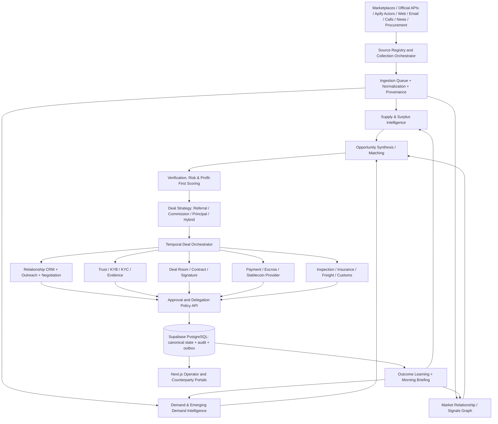

# Opportunity OS — Integrated Architecture and Product Requirements Document
**Version:** 2.0 proposed | **Date:** 2026-10-15 | **Status:** Implementation proposal, not implemented

## 1. Source baseline and scope
This proposal integrates the supplied `Opportunity_OS_Application_Audit.md` (repository `sidnicholas/soko`, main `b64c312` plus uncommitted intel work) and supplied architecture diagram with the requested broad-spectrum commercial opportunity discovery, relationship intelligence and transaction execution. The repository was not independently inspected. The audit explicitly says code and ADRs supersede the audit; validate each change against those sources before implementation.

**Existing, preserve:** strict TypeScript pnpm/Turborepo, NestJS/Fastify API, Next.js web, Railway deployment, Supabase PostgreSQL/auth, Kysely, 20 domain packages, 31 tables/23 migrations, transactional outbox, hash-chained audit/evidence, versioned events, deterministic scoring and settlement, approval-token gates, existing market graph and settlement rail abstraction. Production: API, web, three cron workers, eBay/Reverb, Brave/Claude. Stripe and Circle are **test-only**; Temporal, outbox relay and notification workers are built but **not deployed**. No live real-money transactions. Existing intel has significant low-yield/noise problems. These status distinctions are requirements, not claims that new functionality exists.

## 2. Product vision and success criteria
**Vision:** An operator-first, industry-agnostic, autonomous brokerage operating system that detects emerging demand and surplus supply, identifies monetizable imbalances, sources counterparties, builds trust, negotiates within authorized bounds, coordinates protected settlement and fulfillment, and learns from outcomes. Primary use is the operator's own brokerage, not an immediate public SaaS launch.

**Priority order:** (1) profit potential, (2) probability of close, (3) time to close. Show all three separately; never rank purely by hypothetical gross spread. Distinguish gross revenue, gross spread, estimated net profit, capital required, probability-adjusted expected profit, and cash realization time. Operator can switch ranking profiles but default uses profit-first tiers and risk/feasibility gates.

**North-star measures:** verified realized net brokerage profit, qualified-to-closed conversion, days to collected cash, cost per verified actionable lead, profit per agent/provider dollar, false-positive rate, loss/dispute rate, repeat counterparty rate and percentage of safely automated steps. Instrument baselines before optimization.

## 3. Architectural design rules
1. Preserve modular monolith for canonical transactions and governance; split separately deployable workers by independent scale, credentials, fault domain or latency. Do not create 20 network microservices just because 20 packages exist.
2. **Only the authoritative API/control plane may authorize binding actions**. Workers propose commands and consume events; no direct autonomous database writes that bypass policy, audit or outbox.
3. Preserve exact-term hash approval tokens and proposer != approver. Add *operator-signed bounded delegation* as a new capability: time-limited, revocable policy grant tied to action class, counterparty, category, channel, budget, exposure, approved template and maximum amount. Delegated service decisions must be deterministic, auditable, single-use/idempotent, and require a distinct authorization principal. Do not allow agents to approve their own binding actions.
4. Default deny for unknown regulatory categories, providers, jurisdictions and unverified sources. Model output may recommend but cannot authorize money release, legal compliance, outreach consent or risk acceptance.
5. Persist one canonical deal ID through discovery, contact, agreements, payment, logistics, settlement and closure. Every cross-service event carries deal ID, correlation ID, event version and idempotency key.
6. Use official APIs first; Apify actors only after per-source permission/terms, access, data-use and privacy review. An Apify actor does not transfer scraping compliance responsibility.
7. Separate status `proposed`, `configured`, `sandbox_verified`, `production_verified`; never show simulated escrow, funds or insurance as real.

## 4. Target logical architecture

**Diagram semantics:** API/control plane owns authoritative writes and all permission checks. Arrows to the policy API are requests for authorization, not unconditional execution. Event consumers use the outbox, not shared-table polling where avoidable. Provider secrets remain server-side.

## 5. Deployable services and boundaries
| Service / deployable | Responsibility | Existing extension point | Deployment guidance |
|---|---|---|---|
| `api` / Policy Control Plane | Auth, RBAC, grants, approval tokens, binding commands, audit/outbox, provider webhook validation | `apps/api`, `auth`, `risk`, `domain`, `audit` | Retain always-on; no public direct DB writes |
| `web` | Operator console, counterparties' restricted deal rooms, briefing and review inbox | `apps/web`, `ui` | Retain; add route-level authorization |
| `worker-source-registry` | Find and vet official APIs, sites and Apify actors, assign source policy and yield | `intel`, `connectors-sdk` | New scheduled worker |
| `worker-ingestion` | Apify runs, official APIs, retries, webhooks, throttles, normalization, provenance | `worker-connectors`, `connectors-sdk` | Extract when throughput requires; keep eBay/Reverb operational |
| `worker-supply` | Surplus, capacity, inventory, liquidation and pricing signals | `discovery`, `intel` | New independently scheduled worker |
| `worker-demand` | Active purchase intent, precursors, latent need and demand creation hypotheses | `demand`, `intel` | New independently scheduled worker |
| `worker-market-graph` | Entity resolution, trends, second-order opportunities, semantic and constraint matching | `worker-lifecycle`, `discovery`, `scoring` | Split heavy embeddings/matching from lifecycle cron |
| `worker-relationship` | CRM enrichment, message/call ingestion, memory extraction, contact plans, briefing | new `relationship` package | Separate sensitive data processing and schedules |
| `worker-outreach` | Deliver authorized messages, thread replies, sequence follow-up, opt-out handling | `negotiation`, `messaging`, `worker-notifications` | Separate queue, domain reputation and rate limits |
| `worker-temporal` | Long-running deal, negotiation, documents, payment and fulfillment sagas | existing Temporal workflows | Deploy with Temporal service and durable task queues |
| `worker-provider-events` | Provider webhooks, verification, reconciliation and exception queue | `settlement`, `verifiers-sdk` | Isolate financial event processing; binding mutations via API |
| `worker-fulfillment` | Freight quotes, milestones, inspections, claims, customs evidence | new `fulfillment` package | Separate third-party latency and credentials |
| `worker-learning` | Score calibration, source yield, A/B tests, deal outcome analysis | `scoring`, `intel`, `outcomes` | Scheduled, versioned and replayable |
| `worker-briefing` | Morning operator brief, relationship spotlight, urgent exceptions, optional audio | `worker-notifications` | Scheduled; deliver only through configured channels |

**Not separately deployed initially:** contract template selection, deal strategy, policy rules, escrow predicate evaluator, trust status calculation, financial economics and commission allocation. Keep these as versioned, testable packages within the authoritative core. A provider adapter is not necessarily a microservice.

## 6. Functional requirements
### FR-01 Source discovery and governance
Maintain source registry: source ID, URL, market/country, supply/demand/both, API availability, Apify actor ID/version, permission basis, robots/ToS assessment, data-use constraints, terms review date, contact path, frequency, cost, quality/yield, health and auto-pause. A source cannot activate until permission policy is satisfied. Include Apify dataset ingestion and webhook signatures, job status, backoff, duplicate avoidance, budgets and quarantine for unexpected fields.

### FR-02 Independent supply intelligence
Detect listed stock, surplus, distressed inventory, expiring stock, excess production, unused service capacity, liquidation, price breaks, MOQ constraints, geography, condition and shipping terms. Separate verified listings from inferred surplus. Capture evidence and last-seen timestamps. Do not assume liquidation means title is clear.

### FR-03 Independent demand intelligence
Detect explicit RFQs, purchase requests, hiring/expansion and project signals, unmet needs, recurring consumption, substitutions, procurement cycles and demand creation opportunities. Label observed facts versus inferred intent; require evidence before outbound claims. Send unmet demand to targeted supplier discovery and unmatched supply to buyer search. Retain watchlist hypotheses with expiration/revisit rules.

### FR-04 Opportunity synthesis and economics
Use exact specification, semantic embeddings and hard constraints (location, regulatory, quantity, timing, condition, price). Suppress echo-embedding graph arbitrage until real embeddings and evaluation are configured. Calculate delivered cost, tariffs/taxes where applicable, insurance, FX, payment/escrow, returns, chargebacks, freight, financing and commissions. Gate opportunities with negative expected net economics or unmanageable capital exposure. Default ranking: net-profit tiers, then probability of close, then time to close; show uncertainty and alternative expected-value sort.

### FR-05 Deal strategy and brokerage protection
For each opportunity compare referral fee, fixed sourcing fee, commission, hybrid fee and principal resale. Model who contracts with whom, seller of record, title transfer, tax and warranty liability, payment recipient and required capital. Generate jurisdiction/industry-specific attorney-reviewed templates for brokerage engagement, fee protection, non-circumvention, buyer/supplier terms, NDA, inspection and dispute process. Before disclosing identities, seek enforceable fee protection where appropriate; non-circumvention is not guaranteed protection. Log introduction provenance and authorized disclosure. For principal mode require distinct title, insurance, tax, returns and product-liability assessment.

### FR-06 Relationship memory and operator coaching
Unify organizations, individuals, roles, preferred contact channels, consent, prior communications, meetings, calls, quotes, commitments, buying cycles, preferences, red flags, objections, introductions, outcomes and next actions. Store raw artifacts encrypted/retained per policy; structured memories carry source, timestamp, confidence, access classification, expiration and correction history. Email/calendar/telephony connectors must use user authorization and lawful recording/consent practices; transcripts are not always legally recordable. Provide a pre-call client brief with verified facts, hypotheses, prior commitments, relevant opportunities and suggested questions. Morning digest summarizes top opportunities, follow-ups, relationship spotlight, risk alerts and recommended actions.

### FR-07 Outreach and negotiation
Automate personalized messages using approved templates and policies, with opt-out, sender identity, channel consent, frequency caps, quiet hours and CAN-SPAM/TCPA and applicable privacy rules. Never impersonate a human or fabricate familiarity. Classify inbound replies, map channel identities to counterparties, maintain thread state, detect commitments, and queue material offers or changed terms for authorization. First-contact campaigns should launch with human review, then graduate only narrowly after measured quality. Provide one operator inbox: `needs review`, `autonomous completed`, `awaiting response`, `exceptions`.

### FR-08 Trust and risk
Risk-tiered KYB/KYC based on parties, geography, amount, product, payment rail, fraud indicators and provider requirements. Candidate providers (subject to verification and commercial onboarding): Middesk for KYB; Persona or Stripe Identity for identity; Plaid or equivalent for *permissioned account data*; Escrow.com for eligible third-party escrow; DocuSign/PandaDoc for e-sign; independent inspection providers. **A connected bank account or balance snapshot does not prove funds are reserved or guaranteed.** Use actual funded escrow or bank-issued payment assurance where required. Third-party verification status must come from a provider callback or verifiable document, not an LLM inference. Screen sanctions/export restrictions, beneficial ownership where needed, product legality, tax, privacy and fraud. Introduce step-up checks and freeze/hold procedures.

### FR-09 Trust-forward counterparty deal room
Separate buyer and seller views with controlled progressive disclosure, branded but accurate provider attribution, clear role of broker/principal, identity status, contract status, real funding status, inspection evidence, shipment tracking, release conditions, dispute window, fees and contacts. Never use provider logos or badges implying endorsement without authorization. Distinguish `verified`, `pending`, `not required`, `failed` and `not available`; display exact verification scope and timestamp. Provide accessible security explanations, receipts, timeline, downloadable records and human escalation. Ensure party isolation at API and database authorization levels.

### FR-10 Contracts, signatures and obligations
Template engine selects approved document version by transaction type, jurisdiction, counterparty and risk. E-sign provider adapter stores immutable signed PDF, certificate and webhook verification. Extract contractual milestones, deadlines, payment conditions, liability and dispute venue into obligation records. Material change requires renewed approval/signature. Contract generation is not legal advice; obtain qualified counsel for templates and restricted industries.

### FR-11 Payment, escrow and stablecoins
Retain rail-neutral `SettlementService`. Add external licensed escrow adapter with explicit transaction eligibility, provider API capabilities, reconciliation and payment instructions. Keep Stripe card processing and Circle USDC test paths separate from **legal escrow**; neither automatically supplies escrow protections. Stablecoin option only through appropriate regulated providers with jurisdiction, KYC/AML/sanctions, custody, address, travel-rule applicability, FX/off-ramp, irreversibility and refund controls. Display fee, FX, settlement time, reversibility, risk and party savings before selection. Never automatically release based solely on unverified carrier signals; reconcile final settlement via signed provider webhooks and ledger entries. Commission splits must be contractually authorized and provider-supported. Any regulated money transmission or custody arrangement requires counsel and partner review before production.

### FR-12 Insurance, logistics and delivery
Insurance rules choose cargo, general/professional/product liability, cyber, trade credit and specialist policies as applicable. Insurance provider APIs or broker integrations are candidates; show `quote`, `bound`, `active`, `excluded`, `expired` accurately. Integrate parcel aggregators (EasyPost/Shippo candidates), freight forwarders/3PL, shipment tracking, proof of delivery, inspection, Incoterms, customs broker, import/export documentation, duties, returns and claims. Shipment delivery alone may not satisfy acceptance; link release to contractual evidence and dispute window.

### FR-13 Exceptions and disputes
Create unified exception taxonomy: unverifiable buyer/seller, funds not secured, supplier unavailable, altered banking instructions, contract mismatch, delayed shipment, damaged goods, failed delivery, sanctions hit, refund dispute, chargeback, provider outage, stale data, suspected fraud. Freeze actions when necessary; notify parties and operator; maintain evidence chain, deadlines, appeal and recovery workflows. Provider outage must not silently substitute a weaker payment rail.

### FR-14 Learning and adaptive discovery
Track per-source cost, lead freshness, verification rate, contacted/replied/closed outcomes, realized net profit and false positives. Calibrate closing probability with historical results and confidence intervals; cold-start predictions marked uncalibrated. Optimize source scheduling and search terms with budget guardrails. Retain negative outcomes and reason codes; do not train on sensitive communications without appropriate permissions. Evaluate changes against held-out cases and prevent feedback-loop bias.

## 7. Data model and migrations
Keep existing 31 tables. Add *only when needed*, grouped by owning package:
- `source_registry`, `source_policy_reviews`, `source_runs`, `source_observations`, `ingestion_quarantine` (`connectors-sdk` / `intel`)
- `market_signals`, `supply_capacity`, `demand_hypotheses`, `opportunity_evidence`, `opportunity_economics_versions` (`discovery` / `scoring`)
- `organizations`, `contacts`, `contact_channels`, `contact_consents`, `conversations`, `conversation_messages`, `call_records`, `relationship_memories`, `relationship_tasks` (`relationship`)
- `deal_strategies`, `deal_participants`, `brokerage_fee_terms`, `deal_disclosures`, `counterparty_verifications`, `trust_attestations` (`deal-strategy` / `trust`)
- `authorization_grants`, `authorization_grant_uses`, `automation_policies`, `policy_decisions` (`auth` / `risk`)
- `deal_rooms`, `deal_room_access`, `documents`, `document_versions`, `signature_requests`, `contract_obligations` (`contracts` / `dealroom`)
- `provider_accounts`, `payment_assurances`, `insurance_policies`, `shipments`, `inspections`, `customs_documents`, `claims`, `deal_exceptions`, `reconciliation_entries` (`settlement` / `fulfillment`)
- `briefing_runs`, `learning_evaluations`, `source_yield_metrics` (`briefing` / `learning`)

Use existing `counterparties`, `signals`, `demands`, `supply`, `entities`, `matches`, `opportunities`, `transactions`, `settlement_plans`, `evidence`, `outcomes` and `audit_events` as canonical where feasible; **do not create duplicate truth tables**. Add foreign keys, unique source identifiers, provider IDs, timestamps, retention and data lineage. Preserve idempotent forward-only migrations, RLS coverage, `JSON.stringify` jsonb convention and event/audit/outbox atomicity. For tenant isolation, explicitly enforce ownership in the API and least-privilege DB roles; existing owner connections may bypass RLS.

## 8. New event families and workflows
Events (versioned `.v1`): `source.reviewed`, `source.paused`, `signal.hypothesis_created`, `surplus.detected`, `opportunity.economics_updated`, `deal.strategy_selected`, `relationship.memory_updated`, `outreach.scheduled`, `outreach.sent`, `outreach.reply_received`, `authorization.delegation_granted`, `authorization.delegation_revoked`, `counterparty.verification_changed`, `contract.signed`, `funding.assurance_verified`, `insurance.bound`, `shipment.dispatched`, `shipment.delivered`, `inspection.accepted`, `deal.exception_opened`, `deal.exception_resolved`, `reconciliation.completed`, `briefing.ready`, `learning.model_evaluated`. Verify names against current `EVENT_NAMES` before adding.

Temporal workflows: `sourceCollectionWorkflow`, `emergingSignalResearchWorkflow`, `relationshipOutreachWorkflow`, `brokeredDealWorkflow`, `principalResaleWorkflow`, `contractSignatureWorkflow`, `fundingAndEscrowWorkflow`, `fulfillmentAndAcceptanceWorkflow`, `disputeResolutionWorkflow`, `morningBriefWorkflow`. Prefer composing the three existing Temporal workflows instead of rewriting them. Use compensation actions for canceled transactions; financial actions are not inherently reversible. Ensure Temporal down means no unsafe binding work proceeds; manual/synchronous API paths can remain available with equivalent gates.

## 9. Policy matrix (initial safe defaults)
| Action | Autonomous? | Preconditions |
|---|---|---|
| Source discovery, permitted search, classification | Yes | Source policy, spend and rate caps |
| Create hypotheses, matches, briefs, draft documents | Yes | Provenance and confidence labels |
| First external outreach | Human approval initially | Lawful channel, verified sender, approved message and recipient |
| Follow-up outreach | Conditional | Explicit bounded grant, opt-out checks, volume/quality caps |
| Negotiate nonbinding information | Conditional | Approved limits, no deceptive representations |
| Commit binding terms or sign | Human approval initially | Exact-term token and independent approver |
| Commit principal capital or assume title | Human approval initially | Capital cap, title/liability review, funded plan |
| Collect/move/release funds | No autonomous live release initially | Regulated partner, reconciliation, evidence, exact-term authorization |
| Refund/freeze on suspected fraud | Freeze/hold may auto-trigger | Deterministic risk rules and operator alert |
| Disclose counterparty identity | Conditional | Disclosure policy, fee protection and consent |

Later automated approval is **a future controlled capability**, not a silent weakening of existing invariant. Define hard exposure ceiling across all simultaneous deals, daily spend ceiling, loss ceiling, kill switch and escalation thresholds. Use separate production credentials and approvals for live rails.

## 10. Security, privacy and compliance
Immediate: verify migration 0022 in production; close Supabase REST mission-write bypass from migration 0002; add inbound rate limiting and spam controls; verify real provider webhook signatures; test row isolation under actual application DB role; encrypt sensitive transcripts and documents, enforce retention/deletion and DSAR handling, secure secrets, rotate credentials and protect from prompt injection. Do not ingest private marketplace or messaging content without authority. Review CAN-SPAM, TCPA, call recording consent, sanctions/OFAC, export controls, broker licensing, sales tax, beneficial ownership and jurisdictional escrow/payment requirements as applicable. Implement vendor due diligence and incident response. This is an engineering requirement list, not a legal determination.

## 11. Interface requirements
Operator pages: `Opportunity Radar` (profit-first ranked), `Emerging Demand`, `Surplus Supply`, `Source Registry`, `Relationship CRM`, `Client Brief`, `Outreach Inbox`, `Deal Strategy`, `Deal Pipeline`, `Approval & Delegation Center`, `Provider Reconciliation`, `Exceptions`, `Morning Briefing`, `Learning/ROI`, and `Settings/Compliance`. Counterparty pages: invitation, role and disclosure, deal overview, verified protections, signed documents, secure messages, funding instructions, shipping/inspection, dispute and receipts. Existing 11 screens remain functional and gain linked views, not wholesale replacement. Clear, accessible status labels, dated third-party attestations, real human support and transparent fee disclosures are required.

## 12. API and package changes
Extend `packages/contracts` first with Zod schemas, provider adapters and commands. New packages: `relationship`, `deal-strategy`, `trust`, `dealroom`, `documents`, `fulfillment`, `insurance`, `policy-delegation`, `learning`, `briefing`. Extend existing `intel`, `demand`, `discovery`, `connectors-sdk`, `scoring`, `negotiation`, `risk`, `auth`, `escrow`, `settlement`, `db`, `llm-gateway`. Suggested API groups: `/v1/sources`, `/v1/supply-intelligence`, `/v1/demand-intelligence`, `/v1/relationships`, `/v1/conversations`, `/v1/deals/:id/strategy`, `/v1/deals/:id/room`, `/v1/deals/:id/trust`, `/v1/deals/:id/documents`, `/v1/deals/:id/fulfillment`, `/v1/deals/:id/insurance`, `/v1/automation/grants`, `/v1/briefings`, `/v1/exceptions`, `/v1/analytics/yield`. All routes use API role and object authorization; third-party callbacks verified and deduplicated.

## 13. External provider shortlist (candidates, not verified contracts)
- Collection: official marketplace APIs; Apify actors, datasets and webhooks; Brave/Serper web search.
- Identity: Middesk (KYB), Persona/Stripe Identity (KYC), appropriate sanctions providers; Plaid for permissioned bank data, **not proof of reserved funds**.
- Agreements: DocuSign or PandaDoc e-sign, templates and document evidence.
- Payment: Stripe Connect for supported payment/payout cases, Circle for supported stablecoin workflows, Escrow.com for **eligible actual escrow** subject to API and jurisdiction review; banks/letters of credit for larger trade deals.
- Logistics: EasyPost/Shippo for parcel; freight forwarders, carrier tracking and customs brokers for industrial/international deals.
- Insurance/inspection: licensed brokers and cargo underwriters; independent inspectors; integrate after coverage/claims API diligence.
- Communications: existing SMTP/Mailgun, Twilio, Telegram and WhatsApp; optional telephony transcription only with recording consent.
Provider capabilities, pricing, logos, API availability and legal eligibility must be confirmed directly before implementation. Never assume a third party will expose a real-time balance guarantee, issue insurance automatically or support commission splits.

## 14. Roadmap with acceptance gates
**P0 — Stabilize (before expansion):** production RLS/REST bypass verification and remediation; webhook validation; enable real embeddings or disable noisy graph deals; activate outbox relay; instrument baseline funnel and spend; write ADRs for new policy model. **Pass:** unauthorized REST write blocked, events replay without duplication, measurable source yield.

**P1 — Discovery expansion:** source registry, Apify actor integration, independent demand/supply workers, surplus/emerging hypotheses, provenance, profit economics and watchlist. **Pass:** vetted sources only; reproducible lead evidence; budget adherence; measurable improvement in verified leads per dollar.

**P2 — Relationship and outreach:** CRM, email/call memory ingestion, consent, reply threading, operator client brief, daily digest, approval-first outbound, limited delegation. **Pass:** no unauthorized sends, correct threading and opt-outs, operator can correct/delete memories, briefing source citations.

**P3 — Broker deal execution:** strategy selection, protected introduction, fee terms, e-sign, counterparty deal rooms, KYB/KYC, insurance and inspection flags. **Pass:** full sandbox deal with signed terms and commission accounting, isolation tests and provider verification states.

**P4 — Regulated money and fulfillment:** onboard eligible licensed providers, external escrow, stablecoin option, shipping/inspection/customs, reconciliation, disputes, exceptions. **Pass:** legal/compliance signoff, real-provider sandbox end-to-end, funds state confirmed by provider, no premature release, recovery drill.

**P5 — Learning and selective autonomy:** score calibration, source scheduling, repeat-customer recommendations, narrowly bounded automation grants and optional principal transactions. **Pass:** monitored conversion uplift, hard exposure ceilings, kill switch, policy tests and rollback.

## 15. Acceptance test matrix
- A duplicate Apify listing and official-API listing merge into one canonical entity without losing source provenance.
- A hypothetical demand precursor cannot be represented as a confirmed buyer.
- A $100,000 headline spread with $110,000 landed costs is not ranked as profitable.
- A material counteroffer invalidates the prior exact-term authorization.
- An agent cannot mint and approve its own authorization; expired/revoked delegation is denied.
- Counterparty A cannot read counterparty B's documents, transcripts, pricing or identity until disclosed.
- A bank-balance observation cannot set `funds_secured`; only eligible verified provider evidence can.
- An unsigned, replayed or spoofed payment webhook cannot mark funds settled.
- A disputed shipment blocks release until documented conditions and authorized resolution.
- A revoked consent stops follow-up even when an agent queue is already scheduled.
- A live-rail call cannot run with test-mode configuration or unapproved jurisdiction.
- Temporal retry cannot double-send outreach, charge a payment or transfer funds.
- Source changes, outcome labels and memory corrections are auditable and reproducible.
- Every new table has RLS, and DB writes, state transitions and outbox/audit commits are atomic.

## 16. Implementation instructions for engineering agent
1. Inspect `docs/Opportunity_OS_PROJECT_MEMORY.md`, `docs/Opportunity_OS_TECHNICAL_REQUIREMENTS.md`, all applicable ADRs, code and migrations; reconcile audit claims against actual code. Produce a discrepancy list before coding.
2. Build a feature-to-owner matrix (`package`, `app`, `table`, `event`, `policy`, `provider`, `test`) and migration dependency graph. Do not add parallel copies of existing capabilities.
3. Complete P0 with tests and production verification before expanding external execution.
4. Implement one vertical slice at a time: contracts/schema → migration/RLS → package → API → worker → UI → unit/e2e/security tests → ADR/docs → controlled rollout.
5. Keep every provider keyless in CI with realistic stubs; separate sandbox and production secrets and UI badges.
6. Add observability per provider: cost, latency, failures, rate limits, conversion yield and reconciliation backlog; add alerting and kill switches.
7. Apply database migrations before app deployment; backfill safely; use feature flags and rollback plans; never test against production DB.
8. Require explicit operator approval for any live binding actions until delegated authorization has been independently tested and approved.

## 17. Open decisions for product owner
- Initial geographic jurisdictions and prohibited/restricted deal categories.
- First outreach channels and whether calls will be recorded/transcribed with consent.
- Initial maximum per-deal and aggregate capital exposure; automation spend caps.
- Whether counterparties need self-service accounts at launch or invitation-only deal rooms.
- Escrow and insurance provider eligibility, commercial onboarding and contract terms.
- First freight classes (parcel, LTL/FTL, international ocean/air) and customs support.
- Morning briefing delivery channel/time; dashboard-only until explicitly configured.
- Retention periods for call/email data, relationship memories and documents.

## 18. Definition of done
A feature is complete only when: code and source-of-truth docs agree; Zod contracts and API authorization exist; deterministic policy is tested; migrations and RLS are tested; state transitions, audit and outbox are atomic; cost and provider status are observable; failure/retry/compensation paths work; provider sandbox is verified where relevant; the operator can review evidence and override within permitted limits; and production enablement is explicitly recorded.

**End of integrated PRD v2.0.**
